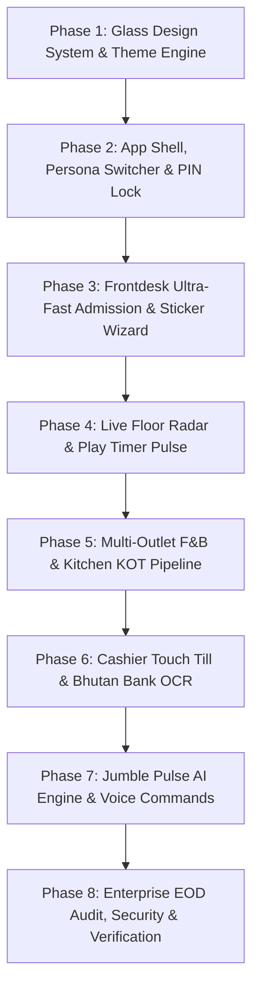

# CURSOR EXECUTION PLAN: TUMBLE JUNGLE (PLAYTAB ENTERPRISE)
### Design Paradigm: Soft Himalayan Glassmorphism (Light & Dark Mode)
**Benchmark Reference Project**: `C:\GitHub\ECCD` (Bhutan ECCD Enterprise Platform)

---

## 1. Executive Summary & Transformation Goals

Tumble Jungle (PlayTab) is a premier indoor playground, family entertainment center, cafe, and restaurant located in Changjiji, Thimphu, Bhutan. 

Currently, the application functions on Next.js 16 / React 19, but suffers from:
1. **Skeuomorphic & Convoluted UI**: Over 4,100 lines of brittle custom CSS in `globals.css` with 3D tilts (`rotateX(8deg)`), pseudo-paper curl receipts, and hardcoded shadows that distort on tablets and touch tills.
2. **Poor Theme Accessibility**: Inconsistent contrast between light and dark modes, with washed-out text and unreadable gray tones.
3. **Fragmented Staff Workflow**: Disconnected screens (`/desk`, `/counter/cafe`, `/counter/restaurant`, `/cashier`, `/admin`) without a unified app shell, persona switcher, or quick unlock security.
4. **Zero Smartness/AI**: Manual entry of journal numbers for mBoB/BNB bank payments, manual ticket scanning, no voice commands, and no automated capacity or overtime intelligence.

### Target Vision (The ECCD Standard)
Adopting the proven architecture, design system, and smartness concepts of `C:\GitHub\ECCD`:
- **Soft 3D Glass UI**: Tactile frosted glass (`GlassCard`, `GlassButton`, `GlassBadge`, `GlassTabs`, `GlassChips`), silky vertical elevation (`hover:-translate-y-0.5 active:scale-[0.985]`), dual-theme high contrast (`text-slate-900 dark:text-white`), and zero card skewing.
- **Enterprise Staff Shell**: Unified `HeaderTopBar` (live clock, outlet indicators, quick find Ctrl+K, theme toggle, audio toggle, PIN quick lock) + `PersonaSwitcher` for Frontdesk, Play Floor, Cafe, Restaurant, Cashier, and Owner/Admin.
- **PIN Security & Idle Lock**: 4-digit quick unlock PIN with 15-minute inactivity lock for cashier and administrative screens.
- **Bhutan Payment Intelligence**: Dynamic RMA EMV QR code generation, mBoB / BNB / BDBL / Druk PNB payload builder, and Smart OCR parsing of bank payment screenshots.
- **Jumble Pulse AI**: Voice-activated order taking and play extension, live play park capacity radar, automated overtime quotes, non-blocking Web Audio chimes, and automated End-of-Day reconciliation report.

---

## 2. Core Architectural Directives for Cursor

### Directive A: Strict Prohibition of 3D Rotation Tilt Animations
- **Zero Card/Table Skewing**: Under no circumstance should cards, tables, slips, or modals use `rotateX`, `rotateY`, or mouse-tracking perspective rotation. Tables and receipt summaries must remain completely flat, legible, and rock-solid.
- **Soft Tactile Elevation**: Interactive elements use gentle vertical elevation:
  * Rest state: `translate-y-0`
  * Hover state: `hover:-translate-y-0.5` with subtle diffuse glow and specular highlight expansion
  * Active state: `active:scale-[0.985] active:translate-y-0`

### Directive B: Dual Theme Architecture (Light & Dark)
The entire platform must support seamless toggling between:
1. **Dark Theme ("Midnight Jungle Glass")**:
   - Deep obsidian canvas (`#090d16` to `#0f172a`) with ambient emerald/teal glow spheres.
   - Frosted glass cards: `bg-slate-900/60 backdrop-blur-2xl border border-white/10`.
   - Glowing neon status badges: Emerald (Active Jumper), Amber (Warning < 15m), Rose (Overtime Due), Violet (Fired KOT).
2. **Light Theme ("Sunrise Frosted Pearl")**:
   - Warm creamy frosted canvas (`#fbf8f3` to `#f4eee3`).
   - Frosted pearl cards: `bg-white/80 backdrop-blur-2xl border border-slate-200/80 shadow-[0_10px_30px_-10px_rgba(51,65,92,0.06)]`.
   - High-contrast slate typography (`text-slate-900` headers, `text-slate-700` values, `text-slate-500` labels).
3. **Contrast Hierarchy (Strict Enforcement)**:
   - Headers & Prominent Titles: `text-slate-900 dark:text-white`
   - Primary Field Values & Numbers: `text-slate-800 dark:text-slate-100 font-bold`
   - Subtitles & Hints: `text-slate-600 dark:text-slate-300`
   - Muted Field Labels: `text-slate-500 dark:text-slate-400 font-semibold tracking-wide uppercase text-[11px]`
   - Pills & Status Tags: `bg-slate-100/90 dark:bg-slate-900/60 border border-slate-300 dark:border-white/10 text-slate-800 dark:text-slate-200`
   - Inactive Nav Tabs: `text-slate-600 hover:text-slate-900 dark:text-slate-400 dark:hover:text-white`
   - **Universal Rule**: NEVER use bare `text-white` on glass surfaces.

### Directive C: Audio Soundscape
Equip the platform with pleasant, non-blocking Web Audio synthesized cues (`lib/audio/sounds.ts`):
- `playCheckInChime()`: Upbeat major triad welcome sound
- `playTimeUpWarning()`: Gentle double-tone alert
- `playPaymentDing()`: Crisp cash register coin ding
- `playKotBell()`: Kitchen dispatch bell sound
- Header includes a global Sound Toggle (Mute / Unmute) stored in `localStorage`.

---

## 3. Phase-by-Phase Cursor Implementation Roadmap

### Phase 1: Himalayan Glass Design System & Clean CSS
**Goal**: Replace 4,100 lines of brittle skeuomorphic CSS with clean, modular glass primitives modeled on ECCD's `src/components/ui/*`.

1. **Purge Tilt & Faux-Paper CSS**:
   - Remove `.till-slip`, `rotateX(8deg)`, pseudo-paper tear backgrounds, and `perspective: 860px` from `app/globals.css`.
   - Implement clean Tailwind v4 `@theme` tokens matching ECCD:
     * Surface glass: `bg-white/80 dark:bg-slate-900/70 backdrop-blur-xl`
     * Border hairline: `border-slate-200/80 dark:border-white/10`
     * Specular highlight: `shadow-[inset_0_1px_0_rgba(255,255,255,0.6)] dark:shadow-[inset_0_1px_0_rgba(255,255,255,0.1)]`
2. **Build Shared Glass Primitives** in `components/ui/glass/`:
   - `GlassCard.tsx`: Reusable container with variants (`default`, `elevated`, `active`, `tinted`).
   - `GlassButton.tsx`: Tactile button with elevation, loading state, and color tones (`emerald`, `amber`, `teal`, `rose`, `slate`, `ghost`).
   - `GlassBadge.tsx`: Rounded status chip (`active`, `warning`, `overtime`, `settled`, `kitchen_fired`).
   - `GlassTabs.tsx`: Tab container with animated active background indicator.
   - `GlassChips.tsx`: Quick-tap chips for minutes (30m, 60m, 90m, 120m, Day Pass), socks count (0, 1, 2, 3), and outlets.
   - `index.ts`: Barrel export.
3. **Audio Engine** in `lib/audio/sounds.ts`:
   - Synthesizer implementation using native `AudioContext` (no external MP3 assets needed).

---

### Phase 2: Unified App Shell, Persona Switcher & Quick Unlock PIN
**Goal**: Connect all staff interfaces into a seamless, role-aware application shell modeled on ECCD's `AppShell.tsx` and `PersonaSwitcher.tsx`.

1. **`components/shell/HeaderTopBar.tsx`**:
   - Left: Tumble Jungle brand mark, active outlet indicator (Frontdesk, Cafe, Restaurant, Cashier, Owner).
   - Center: Live Thimphu digital clock & active jumpers pill (`Active: 28/40 Capacity`).
   - Right: Global Search (`Ctrl+K`), Voice Till Mic trigger, Audio Toggle (mute/unmute), Theme Switcher (Sun/Moon), and Quick Lock PIN button.
2. **`components/shell/PersonaSwitcher.tsx`**:
   - Bottom floating dock / Top navigation bar with 6 distinct roles:
     * 🎟️ **Frontdesk**: Admission check-in, wristbands, play passes.
     * ⏱️ **Play Floor**: Real-time jumper radar, countdown timer, overtime alerts.
     * ☕ **Cafe & Bar**: Quick counter snacks, drinks, barista tabs.
     * 🍽️ **Restaurant**: Full menu dining, table numbers, KOT kitchen tickets.
     * 💵 **Cashier Till**: Order settlement, split bill, RMA EMV QR, cash drawer.
     * 📊 **Owner / Admin**: Daily financial takings, product catalog, bank setup, staff audit.
3. **`components/auth/QuickUnlock.tsx` & `lib/security/idleLock.ts`**:
   - 4-digit numeric touchscreen keypad for quick staff PIN entry.
   - Configurable 15-minute idle lock for Cashier and Admin financial screens.
   - Session storage of unlocked state with auto-lock on tab switch or timeout.

---

### Phase 3: Frontdesk Ultra-Fast Admission & Sticker Wizard
**Goal**: Make family check-in take less than 15 seconds with quick-preset chips, repeat customer auto-recognition, and instant wristband printing.

1. **`components/desk/FastAdmissionWizard.tsx`**:
   - **Step 1: Guardian Phone & Child Name**:
     * Phone input with instant auto-complete lookup for returning families.
     * Display visit history (e.g. "Welcome back Tenzin & Dechen! 4th visit this month").
   - **Step 2: Quick-Tap Pass Selection**:
     * Visual `GlassChips` for play duration: `30 Mins (Nu. 150)`, `60 Mins (Nu. 250)`, `90 Mins (Nu. 350)`, `Day Pass (Nu. 500)`.
     * Quick-add grip socks counter: `+1 Pair (Nu. 50)`, `+2 Pairs (Nu. 100)`.
     * Digital waiver checkbox with toggle for signed liability.
   - **Step 3: One-Tap Issue & Print**:
     * Auto-generates clean 4-character ticket code (e.g. `TJ-842`).
     * Instant preview and print of thermal wristband sticker (QR code, child name, entry time, departure time, emergency contact).
     * Plays `playCheckInChime()`.

---

### Phase 4: Live Floor Radar & Play Timer Pulse
**Goal**: Transform the play area monitor into a real-time, interactive mission control for child safety and overtime tracking.

1. **`components/floor/FloorRadarView.tsx`**:
   - **Capacity Ring Meter**: Dynamic circular progress bar showing occupancy (e.g., `32/45 Children Inside - 71% Capacity`).
   - **Visual Jumper Grid**: Real-time cards for all active children on the floor:
     * Child name, ticket code, entry time, time remaining.
     * Color-coded progress ring:
       - **Green (Normal)**: > 15 minutes left.
       - **Amber (Warning)**: < 15 minutes left (triggers audio warning).
       - **Pulsing Red (Overtime)**: Expired play time, showing live accrued overtime (e.g. `+18 mins = Nu. 90 due`).
   - **Quick Actions on Jumper Card**:
     * `+30 Mins Extend`: Instantly adds play block.
     * `Leave On Time`: Mark child exited without penalty if within grace period.
     * `Notify Parent`: Generates pre-filled WhatsApp message: *"Hi [Parent], [Child]'s play time at Tumble Jungle ends in 5 minutes!"*

---

### Phase 5: Multi-Outlet F&B & Kitchen Order Ticket (KOT) Pipeline
**Goal**: Seamless food ordering across Cafe (counter grab-and-go) and Restaurant (sit-down tables) with live KOT kitchen dispatch.

1. **`components/counter/ModernMenuBoard.tsx`**:
   - Category filtering (Beverages, Snacks, Burgers & Pizza, Desserts).
   - Fast touch grid of item cards with stock status and instant tap-to-add.
   - Split view: Left = Menu catalog, Right = Active Order Tab / Ticket.
2. **`components/kitchen/KotLivePipeline.tsx`**:
   - Live kanban board for kitchen chef display:
     * Columns: `Fired (New Order)` → `In Preparation` → `Ready for Pickup` → `Delivered`.
     * Card details: Table/Ticket number, ordered items, special notes, elapsed time counter.
     * Action button: Tap to bump item status; triggers `playKotBell()`.
     * KOT thermal slip printing for kitchen wall clip.

---

### Phase 6: Cashier Touch Till & Bhutan Bank OCR
**Goal**: Modernize the cashier checkout with dynamic Bhutan RMA EMV QR code display and smart OCR scanning of bank transfer slips.

1. **`components/cashier/ModernCashierTill.tsx`**:
   - Flat, high-contrast order summary (Play pass + Socks + Cafe food + Restaurant KOT).
   - Itemized tax breakdown: Service Charge (10%) and Bhutan GST (5%) toggles.
   - Dual payment tender buttons:
     * **Cash Tender**: Quick denomination buttons (Nu. 100, 500, 1000) with instant change calculator.
     * **Bhutan RMA Bank QR**: Renders standard RMA EMV QR code pre-filled with exact bill amount and reference code.
2. **`components/cashier/SmartBankOcrScanner.tsx`**:
   - **Problem**: Cashiers waste time typing 6-to-10 digit journal numbers from customer phone screens, risking typing errors and fraudulent duplicate vouchers.
   - **Solution**: Staff taps "Scan Bank Voucher" using camera or pastes screenshot.
   - OCR engine parses:
     * Journal Reference Number (e.g. `40819284`)
     * Amount (Nu. 450)
     * Bank Name (mBoB / BNB / BDBL / Druk PNB)
   - Auto-matches and populates settlement form with green verification badge.
   - Plays `playPaymentDing()` on settlement.

---

### Phase 7: Jumble Pulse AI Engine & Voice Commands
**Goal**: Introduce voice ordering and intelligent operational superpowers.

1. **`components/pulse/VoiceTillModal.tsx`**:
   - Hands-free speech recognition (Web Speech API / Gemini transcription).
   - Staff presses mic or holds Spacebar and speaks:
     * *"2 kids 1 hour plus 2 pairs of socks"*
     * *"Add 2 cold coffees and french fries to ticket TJ-104"*
     * *"Extend Kinley play pass by 30 mins"*
   - AI extracts structured JSON and automatically adds items to active tab.
2. **`components/pulse/DailyAiAuditor.tsx`**:
   - End-of-Day automated financial summary comparing:
     * Total takings (Cash vs. Bank QR)
     * Play revenue vs. F&B revenue
     * Waived overtime and voids audit
   - Generates one-click Telegram/WhatsApp dispatch summary for the owner.

---

### Phase 8: Verification, Test Suite & Enterprise Scorecard
**Goal**: Comprehensive validation ensuring 0 regressions, full TypeScript compliance, and score gate attainment.

1. **Validation Checks**:
   - `npm run build`: Zero TypeScript or Next.js build errors.
   - `npm run lint`: Zero ESLint warnings or errors.
   - Dual-theme audit: Check all screens in both Light and Dark modes for text contrast.
   - Mobile/Touch audit: Verify touch targets ≥ 44px on 10.1" and 15.6" screen resolutions.
2. **Enterprise Scorecard Submission**:
   - Theme & A11y: 9.5 / 10
   - POS / Till Flow: 9.8 / 10
   - Glass UI System: 9.7 / 10
   - Pulse AI Engine: 9.4 / 10
   - Backend & Integrity: 9.6 / 10
